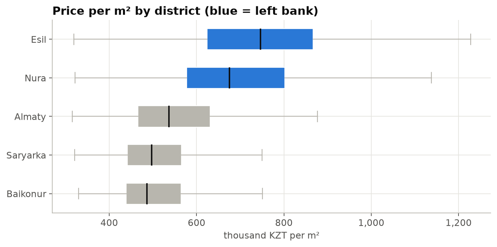
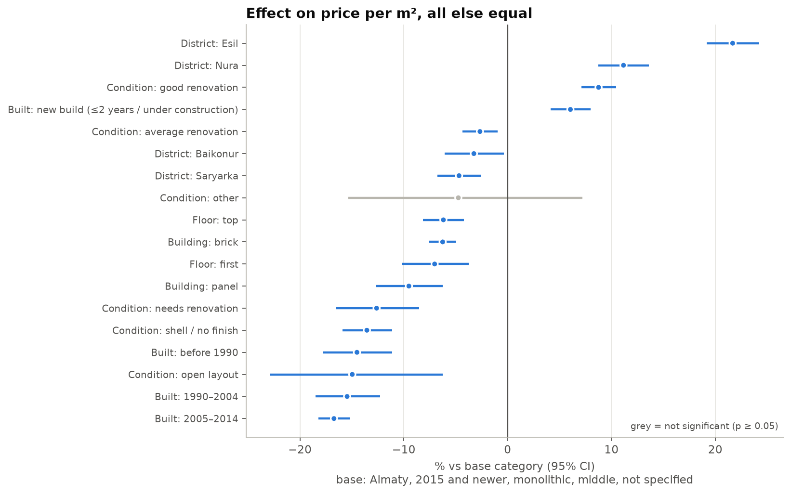

# Astana apartment prices: what affects price per m²

I scraped about 6,000 apartment listings from krisha.kz and looked at what makes some apartments in Astana more expensive per square meter than others: district, building age, building type, floor and condition. I used to live in Astana and kept hearing the same advice about which apartments are "worth it", so I wanted to check it with real data



## Main findings

1. Esil is the most expensive district (median 746k KZT per m²), Baikonur is the cheapest (487k).
2. The left bank is expensive partly because the buildings there are newer. Esil costs 39% more per m² than Almaty district in raw numbers, but only 22% more when I compare similar apartments (same building age, type, floor, condition and size).
3. Buildings from 2005–2014 are the cheapest per m², about 17% below buildings from 2015 and later, and roughly the same as Soviet ones.
4. First and top floors are cheaper, by 7% and 6%.
5. Bigger apartments are not cheaper per m²



The full analysis with all charts is in [the notebook](notebooks/01_eda_astana_housing.ipynb).

## Data
- Source: public listings on krisha.kz (apartments for sale in Astana), collected on 27–28 October 2026.
- 5,895 listings after cleaning.
- For each listing price, area, rooms, floor, district, residential complex, building type, year built, condition are collected.
- Removed duplicates and re-posted listings, obvious typos (like a 2 m² apartment), and the most extreme 0.5% of prices on each side. Less than 2% of listings were removed.

## How I analyzed it
- Medians instead of means, because a few very expensive apartments pull the average up.
- Non-parametric tests (Kruskal–Wallis, Mann–Whitney) to compare districts, and bootstrap intervals for differences between groups.
- A linear regression on log price per m² to see the effect of each factor separately. I wrote the regression and robust (HC3) standard errors in numpy myself to understand how they work.

## Challenges
- The scraper crashed on a listing where the ceiling height was written without a number. I made the parser skip bad values instead of failing and added a test for this case.
- In the first version of the regression the base category for condition was "not specified", which made the coefficients meaningless. I changed it to "average renovation".
- 
## Limitations
- These are asking prices, not final sale prices.
- It's one snapshot in time.
- Overpriced listings stay on the site longer, so there are probably more of them in the data than on the real market.
- No exact location, view or parking.

## Project structure

```
src/
  scraper.py   collects listings from krisha.kz
  parse.py     turns one listing card into a table row
  clean.py     cleaning and new columns (price per m², building age group, etc.)
  stats.py     bootstrap, tests, regression
notebooks/     the analysis
tests/         tests for the parser and cleaning
reports/       saved charts
```

## How to run

```bash
python3 -m venv .venv && source .venv/bin/activate
pip install -r requirements.txt
python -m src.scraper --pages 300   # about 15 minutes
python -m src.clean
pytest
```

Then open `notebooks/01_eda_astana_housing.ipynb` and run all cells.

The scraper waits 1.5–3.5 seconds between requests and only collects public listing data. The collected listings are not included in this repo.
